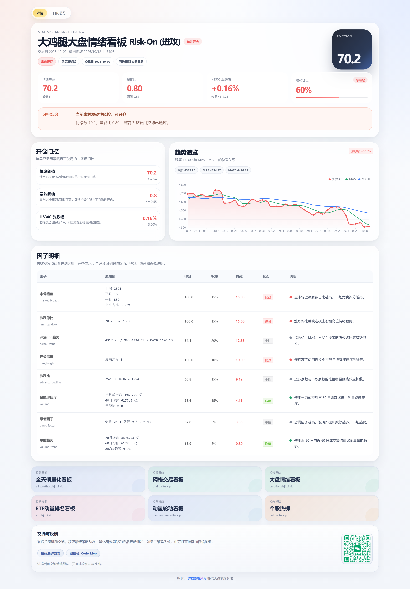
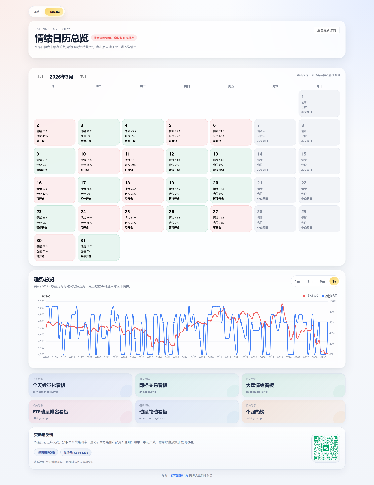

# 大鸡腿大盘情绪看板

把 A 股全市场盘后数据压缩成一个 0–100 的情绪总分，并据此回答三个问题：**今天情绪如何、能不能开仓、该上多少仓位。**





> **定位**：盘后（EOD）择时工具，不是盘中实时信号。所有指标基于收盘后已同步的定稿数据计算。


欢迎扫码进群交流，获取最新策略动态、量化研究思路和产品更新通知,微信号: Code_Mvp。

## 目录

- [它解决什么问题](#它解决什么问题)
- [核心特性](#核心特性)
- [免责声明](#免责声明)
- [快速开始](#快速开始)
- [指标与算法口径](#指标与算法口径)
- [项目结构](#项目结构)
- [API](#api)
- [前端页面与 URL 参数](#前端页面与-url-参数)
- [缓存与持久化](#缓存与持久化)
- [常见问题](#常见问题)
- [开源协议](#开源协议)

---

## 它解决什么问题

收盘后需要判断明天的仓位，但信息是散落的：涨跌家数、涨跌停、连板高度、成交量能、指数趋势，各自量纲不同，无法直接比较，也难以形成稳定一致的操作纪律。

本项目做两件事：

1. **量化**：把 8 个维度的市场状态加权成一个 0–100 的情绪总分，使不同交易日之间可以直接纵向比较。
2. **约束**：叠加 3 条硬性风控门控（情绪阈值、量能阈值、指数跌幅）。任一门控不通过则强制空仓，避免在极端行情中给出激进的仓位建议。

## 核心特性

- **8 因子加权情绪评分**：覆盖趋势、量能、宽度、涨跌比、涨跌停比、连板高度、恐慌情绪
- **3 条硬门控 + 仓位映射**：情绪分直接映射为 90% / 75% / 60% / 45% / 30% / 0% 六档仓位
- **历史回溯**：任选交易日复算，结果落库 SQLite 快照缓存
- **日历总览**：月历视角回看整月情绪分布 + 1m / 3m / 6m / 1y 趋势曲线
- **数据可用性自检**：数据未同步时明确返回 409，而不是用不完整数据算出错误结论
- **收盘前保护**：当日 15:00 前不把当日视为已完成交易日
- **权限降级**：缺少涨跌停价接口权限时自动降级为规则近似，并在响应中明确标注

## 免责声明

本项目为**技术研究与学习用途**的分析工具。所有输出（情绪总分、建议仓位、门控结论）均为基于公开行情数据的程序化计算结果，**不构成任何投资建议**，不承诺任何收益，不对任何投资决策的后果承担责任。

市场有风险，投资需谨慎。请独立判断并对自己的交易决策负责。

---

## 快速开始

### 环境要求

| 依赖 | 版本要求 | 说明 |
|---|---|---|
| Node.js | `^20.19.0` 或 `>=22.12.0` | 下限由 `vite@8` 的 engines 声明决定；`better-sqlite3@12` 支持 20 / 22 / 23 / 24 / 25 / 26 |
| Tushare 账号 | — | 需具备 `trade_cal`、`stock_basic`、`daily`、`index_daily` 权限；`stk_limit` 为可选 |

> 不需要 Python 环境。

### 安装

```bash
npm install
```

### 配置

```bash
cp .env.example .env
```

编辑 `.env`，填入你的 Tushare 令牌：

```ini
TUSHARE_TOKEN=你的令牌
SERVER_PORT=4174
```

令牌申请地址：<https://tushare.pro/user/token>

### 启动

开发模式（前后端同时启动）：

```bash
npm run dev
```

或分开启动：

```bash
npm run start:server   # 后端代理 → http://127.0.0.1:4174
npm run dev:client     # 前端页面 → http://127.0.0.1:5173
```

浏览器打开 <http://127.0.0.1:5173>。

### 构建

```bash
npm run build      # 产物输出到 dist/
npm run preview    # 本地预览构建产物
```

> 注意：构建产物是纯静态文件，但**仍然需要后端代理才能取到数据**。Tushare 令牌不能下发到前端，所有数据请求必须经由 `server/` 代理。

---

## 指标与算法口径

以下口径与 `server/marketEmotion.js` 逐行对应。公式均写到可实现的程度，便于核对与复现。

### 1. 样本域

所有市场统计（涨跌家数、涨跌停、连板高度）只统计以下范围内的个股：

| 范围 | 是否纳入 |
|---|---|
| 沪深主板、创业板（`300`）、科创板（`688`） | 纳入 |
| 北交所 / 新三板（代码以 `8` 开头） | 排除 |
| B 股（代码以 `9` 或 `200` 开头） | 排除 |
| ST / \*ST（证券名称含 `ST`） | 排除 |

实现见 `filterSampleRows()`，名称来自 `stock_basic`（`list_status = L`）。

### 2. 八个因子与权重

| 因子 id | 名称 | 权重 |
|---|---|---:|
| `hs300_trend` | 沪深300趋势 | 0.20 |
| `volume` | 量能健康度 | 0.15 |
| `volume_trend` | 量能趋势 | 0.05 |
| `market_breadth` | 市场宽度 | 0.15 |
| `advance_decline` | 涨跌比 | 0.15 |
| `limit_up_down` | 涨跌停比 | 0.15 |
| `max_height` | 连板高度 | 0.10 |
| `panic_factor` | 恐慌因子 | 0.05 |
| | **合计** | **1.00** |

### 3. 单因子评分

#### hs300_trend — 沪深300趋势

取沪深300（`399300.SZ`）最近 60 根日线，令 `current` 为最新收盘价，`MA5` / `MA20` 为最近 5 / 20 日收盘均值：

```
若 current >= MA5 且 MA5 >= MA20        → 100
否则若 current >= MA5                   → 70
否则                                    → max(0, 70 - (MA5 - current) / MA5 * 1500)
```

单日下跌惩罚（`drop = max(0, -(current - prevClose) / prevClose)`）：

```
若 drop > 3%:  score = max(0, score - (drop - 1.5%) * 5000)
```

#### volume — 量能健康度

基于沪深300指数成交额（`index_daily.amount`）：

```
volumeRatio = 当日成交额 / 60日均额
score       = clamp((volumeRatio - 0.5) / 1.1 * 100, 0, 100)
```

#### volume_trend — 量能趋势

```
volumeTrend = 20日均额 / 60日均额
score       = clamp((volumeTrend - 0.6) / 0.8 * 100, 0, 100)
```

#### market_breadth — 市场宽度

令 `upRatio = 上涨家数 / (上涨 + 下跌 + 平盘)`：

| upRatio | score |
|---|---|
| ≥ 0.50 | 100 |
| 0.45 – 0.50 | `80 + (upRatio - 0.45) / 0.05 * 20` |
| 0.40 – 0.45 | `60 + (upRatio - 0.40) / 0.05 * 20` |
| 0.35 – 0.40 | `40 + (upRatio - 0.35) / 0.05 * 15` |
| 0.30 – 0.35 | `20 + (upRatio - 0.30) / 0.05 * 20` |
| < 0.30 | `upRatio / 0.30 * 20`（下限 0） |

#### advance_decline — 涨跌比

令 `ratio = 上涨家数 / 下跌家数`（下跌家数为 0 时取 999）：

| ratio | score |
|---|---|
| ≥ 5（含分母为 0） | 100 |
| 3 – 5 | 85 |
| 2 – 3 | 70 |
| 1.5 – 2 | `60 + (ratio - 1.5) / 0.5 * 10` |
| 1 – 1.5 | `55 + (ratio - 1) * 10` |
| < 1 | `ratio * 50`（下限 0） |

#### limit_up_down — 涨跌停比

令 `ratio = 涨停家数 / 跌停家数`（跌停家数为 0 时取 999）：

| ratio | score |
|---|---|
| ≥ 5（含分母为 0） | 100 |
| 4.5 – 5 | `95 + (ratio - 4.5) / 0.5 * 5` |
| 3 – 4.5 | `80 + (ratio - 3) / 1.5 * 15` |
| 2 – 3 | `65 + (ratio - 2) * 15` |
| 1 – 2 | `50 + (ratio - 1) * 15` |
| < 1 | `ratio * 50`（下限 0） |

#### max_height — 连板高度

在最近 **5 个交易日**内，对每只个股统计最长连续涨停天数 `h`，取全市场最大值：

| h | score |
|---|---|
| ≥ 5 | 100 |
| 4 – 5 | `80 + (h - 4) * 20` |
| 3 – 4 | `65 + (h - 3) * 15` |
| 2 – 3 | `50 + (h - 2) * 15` |
| 1 – 2 | `30 + (h - 1) * 20` |
| 0 | 0 |

#### panic_factor — 恐慌因子

令 `panic = 炸板家数 + 跌停家数 * 2`：

| panic | score |
|---|---|
| ≤ 10 | 100 |
| 10 – 30 | `80 + (30 - panic) / 20 * 20` |
| 30 – 50 | `60 + (50 - panic) / 20 * 20` |
| 50 – 70 | `40 + (70 - panic) / 20 * 20` |
| 70 – 100 | `20 + (100 - panic) / 30 * 20` |
| > 100 | `20 - (panic - 100) / 20 * 20`（下限 0） |

### 4. 涨跌停判定与近似降级

**优先路径**：使用 `stk_limit` 接口返回的当日涨停价 / 跌停价。

```
涨停：收盘价 >= 涨停价 * 0.995   且   最高价 >= 涨停价 * 0.995
跌停：收盘价 <= 跌停价 * 1.005
炸板：最高价 >= 涨停价 * 0.995   且   收盘价 <  涨停价 * 0.98
```

**降级路径**：当 `stk_limit` 无权限或触发限频时，自动改用涨跌幅规则近似。此时相关因子的 `method` 字段为 `近似`，并在 `dataMeta.approximationNotes` 中说明。

```
涨跌幅上限：代码以 300 开头 → 20%，其余 → 10%
涨停：收盘 >= 前收 * (1 + 涨停幅 - 0.5%)   且   收盘 >= 最高 * 0.995
炸板：最高 >= 前收 * (1 + 涨停幅 - 1%)     且   收盘 <  前收 * (1 + 涨停幅 - 2%)
跌停：(收盘 - 前收) / 前收 < -9.5%
```

> **已知局限**：降级路径的涨跌幅档位只区分创业板（`300`，20%）与其余（10%），**未覆盖科创板（`688`，20% 涨跌幅）**。因此在 `stk_limit` 不可用时，科创板个股的涨跌停与炸板判定存在偏差。若需要精确结果，请为 Tushare 账号开通 `stk_limit` 权限。

### 5. 涨跌家数归类顺序

每只个股按以下**顺序**判定，命中即归类并进入下一只，因此各类别互斥：

1. 涨停 → `涨停数 +1`、`上涨数 +1`
2. 炸板 → `炸板数 +1`、`上涨数 +1`
3. 跌停 → `跌停数 +1`、`下跌数 +1`
4. 涨跌幅 > +0.5% → `上涨数 +1`
5. 涨跌幅 < -0.5% → `下跌数 +1`
6. 其余 → `平盘数 +1`

> 注意：**炸板股计入上涨家数**，这是原始策略公式的设计，并非统计疏漏。

### 6. 情绪总分

```
emotionScore = Σ(因子得分 × 因子权重) / Σ(因子权重)
```

因子权重合计为 1.00，因此等价于加权平均。输出保留 1 位小数。

**市场状态**：

| 情绪总分 | regime | 展示文案 |
|---|---|---|
| ≥ 65 | `strong` | Risk-On（进攻） |
| 41 – 64 | `neutral` | Neutral（中性） |
| ≤ 40 | `weak` | Risk-Off（防守） |

**正向因子占比** `positiveShare` = 所有得分 ≥ 60 的因子权重之和 × 100。

### 7. 三条硬门控

| # | 门控 | 阈值 | 未通过时的 `banReasons` 文案 |
|---|---|---|---|
| 1 | 情绪阈值 | `emotionScore >= 54` | `情绪得分 X < 54` |
| 2 | 量能阈值 | `volumeRatio >= 0.55` | `量能比 X < 0.55` |
| 3 | HS300 跌幅 | `当日跌幅 <= 3.00%` | `HS300 跌幅 X% > 3.00%` |

任一条不通过 → `allowOpen = false`，建议仓位强制为 0，并在 `gateStatus` 中逐条返回门控明细。

### 8. 情绪分 → 建议仓位

仅在 `allowOpen = true` 时执行映射：

| 情绪总分 | 建议仓位 | 档位 |
|---|---:|---|
| ≥ 85 | 90% | 满仓进攻 |
| 75 – 84.9 | 75% | 重仓 |
| 65 – 74.9 | 60% | 标准仓 |
| 60 – 64.9 | 45% | 半仓 |
| 54 – 59.9 | 30% | 轻仓试探 |
| < 54 | 0% | 防守空仓 |
| 门控未通过 | 0% | 空仓观望 |

### 9. 数据源

| Tushare 接口 | 用途 | 内存缓存 TTL |
|---|---|---|
| `trade_cal` | 交易日历 | 24 小时 |
| `stock_basic` | 证券名称（用于 ST 过滤） | 6 小时 |
| `daily` | 全市场日线（涨跌家数、涨跌停、连板） | 60 秒 |
| `index_daily` | 沪深300（60 根）、中证1000（20 根） | 5 分钟 |
| `stk_limit` | 当日涨跌停价（可选，缺失则降级） | 1 小时 |

**交易日自检**：解析默认交易日时，会从最近 6 个交易日向前回溯，确认 `daily`、沪深300、中证1000 三者当日数据均已同步，才认定为有效交易日。否则返回：

- `409 TRADE_DATE_NOT_READY`：收盘数据尚未同步
- `409 INDEX_DATA_NOT_READY`：指数数据尚未同步

**收盘前保护**：当日 15:00 之前，当日不会被当作「已完成交易日」，避免用未收盘的盘中数据得出结论。

---

## 项目结构

```
.
├── index.html
├── vite.config.js                 # 前端开发服务器 + /api 代理至 4174
├── .env.example
├── LICENSE
├── server/                        # Express 数据代理（持有 Tushare 令牌）
│   ├── index.js                   # 路由定义
│   ├── config.js                  # 端口、令牌、SQLite 路径、算法版本号
│   ├── marketEmotion.js           # ★ 情绪因子与评分核心
│   ├── dashboardService.js        # 快照编排、日历与趋势
│   ├── snapshotStore.js           # SQLite 快照持久化
│   ├── tushare.js                 # Tushare 客户端（缓存 + 网络重试）
│   └── utils.js                   # 通用工具与内存缓存
├── src/
│   ├── App.vue                    # 详情页与页面切换
│   ├── components/
│   │   ├── CalendarOverviewPage.vue
│   │   ├── CalendarTrendChart.vue
│   │   └── MarketChart.vue
│   ├── services/                  # axios 实例与接口封装
│   ├── data/                      # 演示用静态数据
│   └── style.css
└── docs/
    ├── plans/                     # 设计文档
    └── screenshots/               # README 配图
```

---

## API

所有接口由后端代理提供，默认监听 `http://127.0.0.1:4174`。

| 方法 | 路径 | 说明 |
|---|---|---|
| GET | `/api/health` | 健康检查 |
| GET | `/api/market/emotion` | 情绪快照（默认最新可用交易日） |
| GET | `/api/market/emotion/history?date=YYYYMMDD` | 指定交易日的情绪快照 |
| POST | `/api/market/emotion/fetch` | 强制抓取并落库指定交易日 |
| GET | `/api/market/trade-dates` | 交易日选项列表 |
| GET | `/api/market/calendar/summary?month=YYYYMM` | 月历总览 |
| GET | `/api/market/calendar/trend?range=1m\|3m\|6m\|1y` | 情绪与仓位趋势序列 |

错误响应统一为：

```json
{ "message": "错误说明", "code": "ERROR_CODE" }
```

---

## 前端页面与 URL 参数

| 参数 | 取值 | 说明 |
|---|---|---|
| `page` | `detail` / `calendar` | 页面切换，默认 `detail` |
| `date` | `YYYYMMDD` | 详情页所选交易日 |
| `month` | `YYYYMM` | 日历页所选月份 |
| `range` | `1m` / `3m` / `6m` / `1y` | 日历页趋势区间 |

示例：<http://127.0.0.1:5173/?page=calendar&month=202610&range=3m>

页面状态与 URL 双向同步，可直接分享链接定位到具体交易日或月份。

---

## 缓存与持久化

两层缓存：

**1. 内存缓存** — `server/utils.js` 的 `withCache`

以「接口名 + 参数」为键，TTL 见数据源表。**仅在请求成功时写入**，失败结果不会被缓存。另有 HTTPS keep-alive 连接复用与瞬时网络错误（`ECONNRESET` 等）的有限次指数退避重试，见 `server/tushare.js`。

**2. SQLite 快照** — `data/market-emotion.db`（首次启动自动创建）

- 表 `market_emotion_snapshots`，主键为 `(trade_date, algo_version)`
- `algo_version` 定义于 `server/config.js`；版本号变更后旧快照自动失效并重建，便于策略迭代时保持数据一致性
- 读取时校验快照是否与交易日对齐（`isSnapshotAlignedWithTradeDate`），未对齐的脏快照会被删除
- **日历页的趋势图数据即来源于此快照库**：只有被计算过的交易日才会出现在趋势序列中

`data/` 已在 `.gitignore` 中忽略，不会进入版本库。

---

## 常见问题

**页面提示「历史数据尚未就绪」**
检查 `.env` 中的 `TUSHARE_TOKEN` 是否已正确填写，以及后端是否已启动（`npm run start:server`）。

**返回 409 `TRADE_DATE_NOT_READY`**
最近交易日的收盘数据尚未同步到 Tushare，通常出现在收盘后 15–30 分钟内。稍后重试即可。

**返回 502 并提示权限不足**
账号缺少对应接口权限。`stk_limit` 缺失会自动降级为近似算法（结果仍可用，精度下降）；`daily` / `index_daily` 缺失则无法运行。

**前端能打开但数据为空**
后端未启动，或端口不是 4174。前端默认请求 `http://127.0.0.1:4174/api`；如需改动，请同步修改 `vite.config.js` 的 proxy target 与 `.env` 中的 `SERVER_PORT`。

**`better-sqlite3` 报 `NODE_MODULE_VERSION` 不匹配**
原生模块与当前 Node 版本的 ABI 不一致，常见于切换过 Node 版本之后。执行 `npm rebuild better-sqlite3`，或删除 `node_modules` 后重新 `npm install`。

**日历趋势图缺少某些交易日**
趋势数据来自本地快照库，只包含已被计算过的交易日。在详情页选择该日期访问一次即可生成快照。

---

## 开源协议

[MIT License](./LICENSE)

## 致谢

- 行情数据来源：[Tushare Pro](https://tushare.pro/)
- 大盘情绪算法：由「[饕餮风月](https://mp.weixin.qq.com/s/E2EQ0e442-PNN43x6Mn5WA)」提供

---

**再次提示**：本项目所有输出均为程序化计算结果，**不构成投资建议**。
